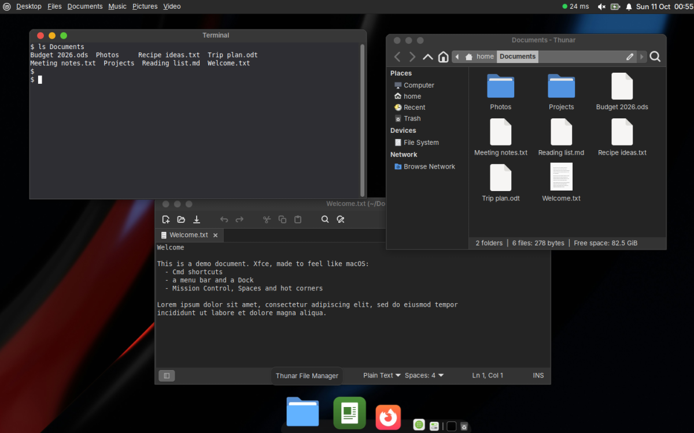
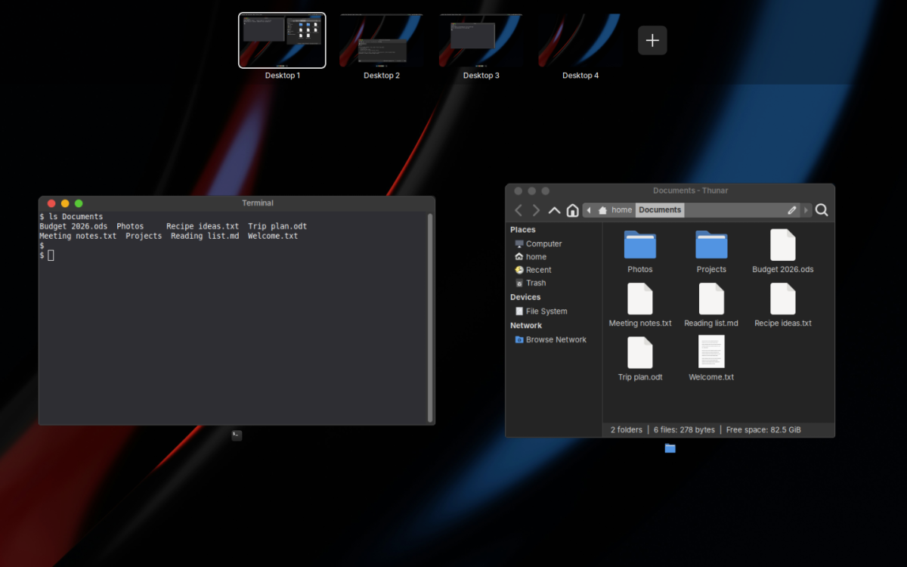
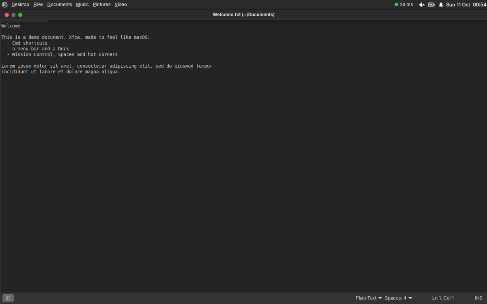
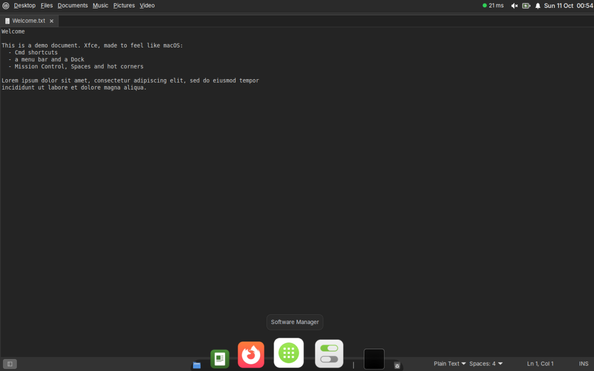
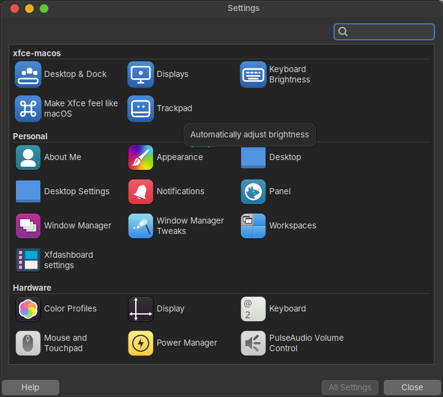
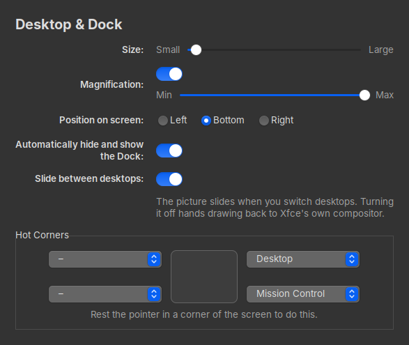
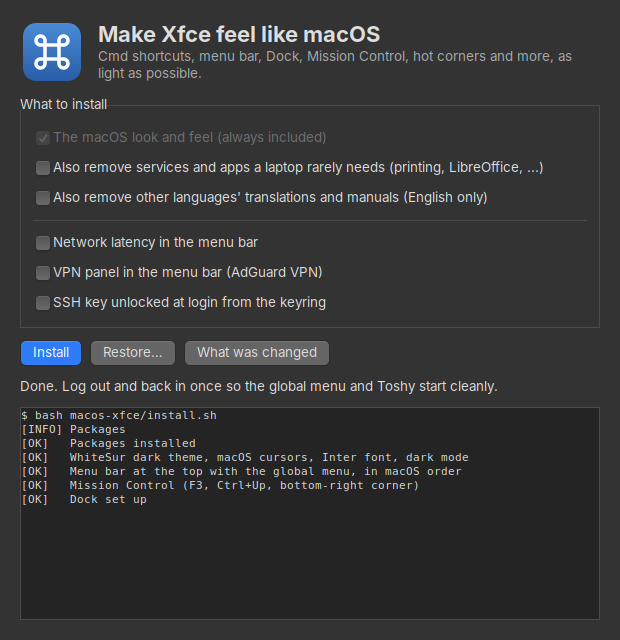

# xfce-macos

**Make Xfce on Linux Mint feel like macOS, as lightly as possible.**

<p align="center">
  
</p>

For old Macs and low-end laptops, where macOS no longer updates or a heavy desktop no longer fits. The
goal is that someone coming from a Mac doesn't have to relearn anything: the same shortcuts, gestures,
menu bar, Dock, Mission Control, hot corners, and settings with the same names, where a Mac user would
look for them. Every part is built with performance and a low footprint in mind (see
[Light by design](#macos-xfce)).

If you like this or find it useful, support the project by buying me a coffee.

<a href="https://www.buymeacoffee.com/antoniocosta" target="_blank"></a>

**What you get**

- **Cmd-key shortcuts** (Cmd+C/V/T/W/Q, Cmd+Tab, Cmd+Space, Cmd+Shift+3/4/5) through [Toshy](https://github.com/RedBearAK/toshy)
- **A menu bar** with a global menu and the macOS order of status icons, and **window buttons on the left**
- **A Dock** with magnification, in the WhiteSur theme, and macOS cursors and fonts
- **Mission Control**: a Spaces bar of all your desktops with their pictures, the current desktop's windows
  below; drag windows between desktops, add and reorder desktops
- **Full screen like macOS**: the green button and Cmd+Ctrl+F; the app gets a Space of its own, and the
  menu bar, title bar and Dock come back at the screen edges
- **Hot corners** (set on the Desktop & Dock page), a **slide** between desktops, 3-finger swipes
- **Settings pages named like macOS's System Settings**, in their own section of Xfce's Settings Manager
- **Spotlight and Launchpad** (Cmd+Space, F4), screenshots, the volume click, automatic brightness on Macs
- **A setup window** and a full **restore**, so you can undo it

<table>
  <tr>
    <td width="50%"><br><sub><b>Mission Control.</b> Every desktop with its picture on top, the current desktop's windows below.</sub></td>
    <td width="50%"><br><sub><b>Full screen.</b> Rest the pointer at the top: menu bar and title bar, with the green button to leave.</sub></td>
  </tr>
  <tr>
    <td><br><sub><b>The Dock</b> over a full-screen app, at the bottom edge.</sub></td>
    <td><br><sub><b>Settings Manager</b> with a section of its own for the macOS-style pages.</sub></td>
  </tr>
  <tr>
    <td><br><sub><b>Desktop &amp; Dock</b>, with the Hot Corners on the page.</sub></td>
    <td><br><sub><b>The setup window.</b> Install, update or restore, with a log of what it does.</sub></td>
  </tr>
</table>

<sub>The pictures are taken from a neutral demo scene by [`docs/screenshots.sh`](docs/screenshots.sh), on a private
invisible display, so you can re-take them after a change; nothing personal is in them.</sub>

`macos-xfce/` is the whole thing: one installer sets up everything macOS does. Each part lives in
its own folder inside it and can also be installed alone. Small tools that aren't about the macOS
feel (a network latency badge, a VPN panel, the SSH key from the keyring) live next to it in
[linux-utilities](https://github.com/antoniocosta/linux-utilities).

```
macos-xfce/          the core: ./macos-xfce/install.sh sets up all of it
  hotcorner/         ├ hot corners
  desktop-slide/     ├ the slide between desktops
  volume-feedback/   ├ the volume click
  disk-label/        ├ "Macintosh HD" with free space on the desktop
  auto-brightness/   ├ automatic screen and keyboard brightness
  fullscreen/        ├ full screen: green button, its own Space, menu bar at the top edge
  mission-control/   ├ Mission Control: the Spaces bar on top, the current desktop's windows below
  settings/          ├ macOS-style settings pages in Xfce's Settings Manager
  setup-app/         └ a small window to install, update or restore
lib/common.sh        helpers shared by the installers
docs/                the screenshots and the script that takes them
```

| Part | What it does |
|---|---|
| [macos-xfce](#macos-xfce) | The macOS look and feel for Mint Xfce: Cmd-key shortcuts, menu bar with a global menu, dock, Spotlight, Launchpad, Mission Control, Spaces with the slide, Cmd+Tab, screenshots, macOS cursors, and the parts below. |
| [hotcorner](#hotcorner) | Hot corners: top right shows the desktop, bottom right opens Mission Control. A tiny C program. |
| [desktop-slide](#desktop-slide) | The macOS slide when you switch desktops (Spaces) with Ctrl+arrows or a 3-finger swipe. |
| [volume-feedback](#volume-feedback) | The click when you change the volume. |
| [disk-label](#disk-label) | A "Macintosh HD / 91 GB free" icon on the desktop, with live free space. |
| [auto-brightness](#auto-brightness) | Screen and keyboard backlight follow the room light, like a MacBook (needs its light sensor). |
| [mission-control](#mission-control) | Mission Control: every desktop in a Spaces bar on top, the current desktop's windows below; drag windows between desktops, + and × to add and remove desktops. |
| [settings](#settings) | Settings Manager pages named like macOS's System Settings: **Desktop & Dock** (Dock size, magnification, position, auto-hide, **Hot Corners**, sliding between desktops), **Trackpad**, **Displays** and **Keyboard Brightness** (automatic brightness). |
| [fullscreen](#fullscreen) | Full screen like macOS: the green button and Cmd+Ctrl+F go full screen in a Space of its own; at the top edge the menu bar and title bar slide in. |
| [setup-app](#setup-app) | A small window to install, update or restore, with a log of what it does. |

Tested on Linux Mint 22.3 Xfce (X11) on a MacBook Air mid 2012 (Intel HD 4000, 8 GB). Nothing is tied to
that machine: Mac-only parts (fan control, light sensor, Apple trackpad thresholds) switch themselves on
only where the hardware is there. See [Hardware notes](#hardware-notes) for what to expect elsewhere.

## Install

```
git clone https://github.com/antoniocosta/xfce-macos.git
cd xfce-macos
./macos-xfce/install.sh                  # everything (asks for sudo once, for packages)
```

Then **log out and back in** once (the global menu and Toshy need a fresh session).

Options, all off by default:

```
./macos-xfce/install.sh --trim           # also switch off services and remove apps a laptop rarely needs (see Trim)
./macos-xfce/install.sh --english-only   # also remove other languages' translations, help and manuals
./macos-xfce/install.sh --user           # skip packages (already installed): no sudo
./macos-xfce/install.sh --restore        # undo what the installers changed (see Restore)
./macos-xfce/install.sh --list-changes   # show what they changed
```

One part on its own: its `install.sh`, for example `./macos-xfce/hotcorner/install.sh`.

Everything is safe to re-run: each step checks before it changes anything, and what you changed
afterwards is kept: the Dock settings you set in Desktop & Dock, the desktop slide if you turned
it off, the number of desktops, your Dock items. Programs go in
`~/.local/bin`, settings in your Xfce settings and `~/.config`. Where a file is shared with other
tools (`gtk.css`, `~/.xsessionrc`, Firefox's `user.js`, Toshy's config), the change sits in a
block marked `xfce-macos` that a re-run replaces instead of duplicating.

## Hardware notes

Developed and tested only on a **MacBook Air mid 2012** (Intel HD 4000, 8 GB, Broadcom Wi-Fi) running
**Linux Mint 22.3 Xfce on X11**. Everything below about other machines is expectation, not something
that has been tested.

- **Which machines.** Intel Macs up to about 2017 should work as they are: nothing in the setup is specific
  to the Air. Macs from 2018 to 2020 with the T2 chip need the [t2linux](https://wiki.t2linux.org) kernel
  and drivers first, which are not covered here. Apple silicon Macs are not supported by this installer
  (it targets x86 Linux Mint). Any PC laptop with Xfce on X11 can use it: the Mac-only parts (fan control,
  the ambient light sensor, trackpad thresholds) switch themselves on only where the hardware exists.
- **Wi-Fi.** Many Macs use a Broadcom Wi-Fi chip that needs a proprietary driver. On a Mac with a matching
  Broadcom card the installer adds `broadcom-sta-dkms`, but it needs a network connection to download it:
  **install Linux Mint over a cable or USB tethering first**, then run the installer.
- **Nvidia graphics (MacBook Pros from about 2008 to 2014).** Use the open-source `nouveau` driver that Mint
  installs, and avoid the old proprietary legacy drivers, which are unmaintained. The desktop slide uses
  picom's OpenGL backend, which has not been tried on Nvidia here.
- **The FaceTime camera** needs a separate driver (`facetimehd`) that this does not install; it is
  reported to prevent sleep while loaded.
- **Disk encryption** is chosen in Mint's own installer and is not affected.
- **Fn and Control** are not swapped, on purpose: an Apple keyboard already has Fn at the bottom left, the
  macOS layout.
- **X11 only.** These helpers watch windows and the pointer, which Wayland does not allow, so Xfce on
  Wayland is not supported.
- **Linux Mint 22.x Xfce** is what the installer targets today. Xubuntu support is planned, not done.

## Footprint

Measured on the 2012 MacBook Air over a 12-hour session (resident memory, average CPU):

| Process | Memory | CPU |
|---|---|---|
| hotcorner | 3 MB | 0.01 % |
| fullscreen | 9 MB | 0 (sleeps until a window changes; watches the pointer only in full screen) |
| volume-feedback | 11 MB | 0 (sleeps until the volume changes) |
| disk-label | 4 MB | 0 (checks once a minute) |
| mission-control (waiting) | 2 MB own, 7 MB with shared | 0 (wakes only on a desktop switch) |
| Touchégg client | 15 MB | 0 |
| Plank (dock) | 57 MB | 0 |
| picom (desktop slide; replaces Xfce's compositor) | 79 MB | 0.3 % |

picom under a redraw load: Xfce's own compositor 7.8 % CPU, picom with vsync 13.9 %, picom
without vsync 9.9 % (used; no visible tearing). `desktop-slide off` goes back to Xfce's
compositor.

---

## macos-xfce

**Light by design.** Everything here is chosen for performance and a small footprint first,
so it runs well on a 2012 MacBook Air with 2 cores and the oldest Intel graphics that still work.
The rules every part follows:

- **Xfce's own features first.** Desktops, window dragging across them, the Cmd+Tab switcher,
  notifications and the menu bar are Xfce's, only configured. Nothing replaces the window manager
  or the panel.
- **No resident process unless it must be one.** Helpers are a few lines of shell, Python or C
  and sleep until something happens: volume-feedback waits on audio events, settings dialogs only exist while open.
- **When something must poll, it polls cheaply.** hotcorner asks X for the pointer position
  5 times a second and speeds up only near a corner (3 MB, about 0.01 % CPU).
- **The heaviest part is optional.** The desktop slide needs a compositor (picom, 0.3 % CPU on
  average); `desktop-slide off` goes back to Xfce's own.
- **Less running in the background.** `--trim` switches off services a laptop rarely needs (about
  350 MB of RAM back on the test machine); Firefox gets fewer processes and unloads idle tabs.
- **Measured, not assumed.** Every part's memory and CPU are checked on the test machine after
  each change; see [Footprint](#footprint).

| macOS | Here | How |
|---|---|---|
| Cmd-key shortcuts (Cmd+C/V/T/W/Q…, Cmd+C/V in terminals; Ctrl+C still interrupts) | same | [Toshy](https://github.com/RedBearAK/toshy), plus keymaps in its `user_apps` slice (`toshy-keymaps.py`) |
| Cmd+Tab | app icons from every desktop, dark rounded panel | Xfce's switcher, styled in `files/gtk3-overrides.css` |
| Ctrl+Tab / Ctrl+Shift+Tab | next / previous tab | Toshy keymap |
| Ctrl+← / Ctrl+→ | previous / next desktop, with the slide | `desktop-switch` ([desktop-slide](#desktop-slide)) |
| green button, Cmd+Ctrl+F | full screen in its own Space; menu bar and title bar at the top edge | [fullscreen](#fullscreen) |
| Ctrl+↑, F3, 3-finger swipe up, bottom-right corner | Mission Control: the Spaces bar on top, the current desktop's windows below | [mission-control](#mission-control) |
| F4 | Launchpad: full-screen app grid, type to filter | rofi, `files/.config/rofi/launchpad.rasi` |
| Cmd+Space | Spotlight-style app search | rofi, `files/.config/rofi/config.rasi` |
| Cmd+Shift+3 / 4 / 5 | full screen / area / tool, saved to `~/Pictures/Screenshots` | xfce4-screenshooter |
| 3-finger swipe left / right / up / down, spread thumb and three fingers | previous / next desktop, Mission Control open / closed, show desktop | Touchégg, `files/.config/touchegg/touchegg.conf`; its client runs under `touchegg-client`, which restarts it if it crashes |
| Spaces | one desktop to start with; add more in Mission Control (+, or drag a window onto it), remove them with its ×; drag a window against the left/right screen edge to carry it to the next one | Xfce's window manager (`wrap_windows`) + [mission-control](#mission-control) |
| a window asking for attention | takes you to its desktop (Xfce's default pulls it to yours) | Xfce `activate_action = switch` |
| menu bar | menu · app menu (global menu) ··· status icons · volume · battery · notifications · clock | xfce4-panel + `xfce4-appmenu-plugin` |
| Dock | Plank Reloaded: WhiteSur theme, magnification, auto-hide; Finder (Files), Launchpad, Firefox, App Store (Software Manager), System Settings, Downloads, Trash | `files/plank-dock1.dconf`; a dock you already arranged keeps its items |
| look | WhiteSur dark window theme, Inter font, macOS cursors, Mint's app icons with a horizontal macOS battery, dark mode for Firefox and GTK4 apps too | `setup_theme` |
| window buttons | close / minimize / maximize on the left, centred title | Xfce window manager |
| desktop | "Macintosh HD / 91 GB free", USB drives and servers in a column at the top right | xfdesktop + [disk-label](#disk-label) |
| Firefox | trackpad scrolling slowed to macOS speed, smooth two-finger scrolling and pinch-to-zoom (Firefox needs `MOZ_USE_XINPUT2=1` on X11; it is set at login in `~/.xsessionrc`, so quit Firefox fully and log in again once), leaner (4 content processes, tabs unloaded when memory runs low, no telemetry or sponsored content; site isolation kept), hardware video decoding where the GPU has it | Firefox `user.js` |

Also: notifications at the top right, without Wi-Fi "connected" pop-ups; menu bar status icons in
a fixed order and one battery icon; window buttons on the left in apps that draw their own title
bar too (Firefox, GTK4); `mbpfan` (fan control) and the Broadcom Wi-Fi driver on Macs, `tlp`
(battery life) on laptops, zram (compressed swap in RAM), the VA-API `i965` driver on older Intel
GPUs, and the Update Manager shield shown only when there are updates.

### Trim (`--trim`)

Background services and preinstalled apps that a typical laptop doesn't need. About 350 MB
of RAM and 1.5 GB of disk on the test machine.

| What | Why | Undo |
|---|---|---|
| printing (`cups`, `cups-browsed`) | cups-browsed keeps scanning the network | `sudo systemctl enable --now cups cups-browsed` |
| `kerneloops`, `motd-news` | crash reports, login news | `sudo systemctl enable --now kerneloops motd-news.timer` |
| `ModemManager` | no mobile modem | `sudo systemctl unmask ModemManager` |
| `colord` + `xiccd` | no colour profiles | `sudo systemctl unmask colord` |
| `rsyslog` | journald already keeps every log | `sudo systemctl unmask rsyslog syslog.socket` |
| `fwupd`, `boltd` (Macs only) | Apple ships no firmware through fwupd; no boltd needed for Thunderbolt 1/2 | `sudo systemctl unmask fwupd bolt` |
| `switcheroo-control` (one GPU), `iio-sensor-proxy` (no rotation sensor) | nothing to switch or rotate | `sudo systemctl unmask …` |
| LibreOffice, Thunderbird, GNOME Calendar, Yaru icons, Mint-L theme | rarely used / unused | reinstall from Software Manager |
| calendar and contacts services, reminder popups, GNOME Online Accounts | only GNOME Calendar used them | `systemctl --user unmask evolution-source-registry evolution-calendar-factory evolution-addressbook-factory` |
| tray icons: printer, System Reports, Toshy | printing is off; System Reports polls constantly (it's still in the menu); the keys work without Toshy's icon | delete their files in `~/.config/autostart/` |
| PackageKit's debconf helper | can busy-loop at 100 % CPU for a minute after login; Mint's tools don't need it | `systemctl --user unmask pk-debconf-helper.socket pk-debconf-helper.service` |

Kept on purpose: the previous kernel, Chinese/Japanese/Korean fonts (otherwise such text shows
as boxes), Bluetooth, `avahi`, `thermald`, Thunar's daemon.

### English only (`--english-only`)

Removes other languages' app translations, help pages and manuals, and adds
`/etc/dpkg/dpkg.cfg.d/90-english-only` so updates keep it that way. Region formats (dates,
numbers) are not affected. Undo: delete that file and reinstall a package to get its
translations back.

### Gotchas

- Toshy turns the physical **Ctrl key into Super in GUI apps** (it stays Ctrl in terminals), so
  Ctrl shortcuts are bound as `<Super>…`.
- The global menu loads through `GTK_MODULES` at login. Switching it on live crashes running tray
  apps, so it only appears after logging in again.
- A Toshy reinstall brings its rainbow tray icon back; re-run the installer.

### Undo

All of it at once: `./macos-xfce/install.sh --restore` (see [Restore](#restore)). By hand:

- Theme, menu bar, shortcuts: Settings → Appearance / Window Manager / Panel / Keyboard.
- Desktop slide: `desktop-slide off`.
- Helpers: delete their entries in `~/.config/autostart/` and log out.
- Marked blocks: delete the `xfce-macos` blocks from `~/.config/gtk-3.0/gtk.css`,
  `~/.xsessionrc`, the Firefox profile's `user.js` and `~/.config/toshy/toshy_config.py`.

---

## hotcorner

Move the pointer into a corner and rest it there for a moment: top right shows the desktop (do
it again to bring the windows back; nothing happens in a full-screen app, as on macOS), bottom
right opens Mission Control. It doesn't fire while a mouse button is held, so dragging a window
or a file into a corner does nothing (the wait starts when you let go). A corner fires once: it
is armed again only after the pointer has gone 30 pixels away, so a finger resting on the
trackpad can't set it off twice and undo what it just did. The corners follow a change of
resolution.

**Show desktop** is per desktop, as on macOS: it hides the windows of this desktop only, and
the same again (or the pinch back in) brings back exactly those, the window you were using
last and with the focus. It does nothing on an empty desktop or in a full-screen app. The
windows it hid carry a mark on themselves, so full-screen Spaces or Mission Control renumbering
the desktops can't lose them. `show-desktop --hide` and `--restore` are what the spread and the
pinch run.

`hotcorner.c` asks X where the pointer is 5 times a second, and 50 times a second only while the
pointer is near a corner, so it reacts quickly and still uses almost nothing. Polling, rather
than an invisible window in the corner, keeps it working when the dock or a full-screen window
covers the corner. `hot-corners` starts it with the corners and restarts it if it ever stops.

---

## desktop-slide

Xfce switches desktops instantly. macOS slides the old desktop out and the new one in, in the
direction you swiped. Xfce's compositor can't animate, and Mint's picom (v10) can only fade, so
this builds picom v13 from source, which has animations. picom knows nothing about desktops or
directions, so `desktop-switch` marks the windows that leave and arrive with
`_MAC_SLIDE = fwd/back` just before switching, and picom's rules (`picom.conf`) slide them by a
screen width in 0.35 s. Switches from Cmd+Tab or Mission Control stay instant, as on macOS.
`desktop-switch` is a small C program on one X connection (a few milliseconds, no process per
window): quick repeats each count, the newest switch clears the marks, and it never wraps
around. picom runs under `picom-slide`, which starts it again if it dies; `desktop-slide on` checks
that picom really started, and if it keeps failing Xfce's own compositor is switched back on, so the
screen is never left without one.

```
desktop-slide on | off | status    # off: back to Xfce's own compositor
desktop-switch next | prev         # what Ctrl+arrows and the swipes run
```

---

## volume-feedback

Plays the freedesktop volume click whenever the output volume changes, like macOS. It listens to
`pactl subscribe`, so it sleeps until something happens. Silent while muted; quick repeats
restart the click instead of piling up.

---

## disk-label

Xfce's desktop can't show free space under the File System icon, so this keeps a launcher on the
desktop named "Macintosh HD" with the free space underneath (decimal gigabytes, like macOS). It
opens `/` in the file manager, checks once a minute, and only rewrites the launcher when the
number changes.

---

## auto-brightness

MacBooks have an ambient light sensor that Linux exposes but nothing uses. This reads it every
2 seconds, smooths it, and moves the screen backlight along a curve, one step at a time; the
keyboard backlight fades on in the dark and off in bright light. When you change the brightness
yourself, it keeps that offset, like macOS. Brightness is set through logind, so no root is
needed. Turn screen or keyboard on and off in Settings Manager → **Auto Brightness**.

The keyboard light also goes off when the screen goes to sleep for lack of activity, and comes
back at the first key press or touch. It follows the screen's own power-save time (the one Xfce's Power
Manager sets from its Display settings, swapped when you plug or unplug the charger), so there is
one setting for both and nothing new to configure. `idle-watch`, a small C program, asks the X
server to tell it when that time has passed and when you are back, so it sleeps in between. The
time is the earliest of the display's power-save time and the screen saver's (the screen locker
locks then, and locking hands your session to the login screen, which can stop the light from being
changed), and the light goes off 10 seconds before it. If the light ever does not change, a few lines
in `~/.local/state/auto-brightness.log` say what it was asked to do and what happened.

Installs only where there is a light sensor.

---

## mission-control

macOS Mission Control. The **Spaces bar** across the top shows every desktop, with a full-screen
app's Space named after the app; below it, the **current desktop's windows**, side by side, with
their icons (and the title of the one under the pointer). As on macOS, a full-screen app is only
in the bar, never among the windows; opened from a full-screen app, Mission Control shows the
windows of the desktop that app came from (and goes back to the app if you pick nothing).

- Click a window to go to it; click a desktop to switch to it; Esc, F3, Ctrl+↑, a 3-finger swipe
  down or a click on empty space closes it.
- Drag a window onto a desktop to move it there, or onto **+** to give it a desktop of its own.
- **+** adds a desktop; the **×** on a hovered desktop removes it (its windows, minimized ones
  too, move to the nearest ordinary desktop; on a full-screen Space it leaves full screen). A
  desktop that full-screen apps came from has no ×: leave those apps first.
- Drag a desktop along the Spaces bar to reorder the desktops; their windows go with them, and
  its full-screen Spaces stay right after it. A Space itself can't be dragged, and a window can't
  be dropped on one (a Space belongs to its app alone).
- It follows changes while open: a window closing, a desktop added in Xfce's settings.
- Up to 16 desktops, full-screen Spaces included, as on macOS (the **+** goes away at 16; an app
  going full screen then stays on its own desktop).

How it stays light: one small C program that sleeps in the background (about 2 MB of its own).
X keeps no picture of hidden desktops, so when the window manager reports a change on the current
desktop (you arrived there, or a window opened, closed, moved or resized; no timer) it waits a
second for things to settle and takes one small snapshot: that's the desktop's picture in the
Spaces bar. A picture belongs to the windows it shows, not to a desktop number, so it survives
desktops being added, removed or reordered. Empty desktops show the wallpaper; a desktop you
haven't visited since login shows its windows' outlines and icons. While open, the windows are drawn from their own composited images, so they're live, over
the desktop's wallpaper (decoded at screen size when it opens, freed when it closes).

```
mission-control              toggle (F3, Ctrl+↑, the bottom-right corner)
mission-control --open       open (3-finger swipe up)   --close: close (swipe down)
```

---

## settings

Where a Mac user looks for things, with the same names, in Xfce's **Settings Manager**. Ours are in a section of their own, **xfce-macos**, at the top (apart from Personal, Hardware, System and Other), with a blue icon, so they are never confused with Xfce's own; the setup window has its entry there too, **Make Xfce feel like macOS**. Changes apply
as you make them. A page is just a window: nothing runs after you close it.

| Page | What's there |
|---|---|
| **Desktop & Dock** | Dock **Size**, **Magnification** (and its size), **Position on screen** (Left, Bottom, Right), **Automatically hide and show the Dock**, **Slide between desktops**, and the **Hot Corners**, right on the page |
| **Hot Corners** (on the Desktop & Dock page) | A choice per screen corner, applied as you change it: Mission Control, Desktop, Launchpad, Lock Screen, Put Display to Sleep, or nothing. Saved in `~/.config/xfce-macos/hot-corners.conf`; the corners restart a moment after you change one |
| **Trackpad** | **Tap to click**, **Natural scrolling** (as on a Mac), **Tracking speed**, **Scrolling speed** (how far your fingers travel per scroll step; Xfce has no window for it, so it is saved and re-applied at every login) |
| **Displays** | **Automatically adjust brightness**, only on computers with an ambient light sensor |
| **Keyboard Brightness** | **Adjust keyboard brightness in low light**, only with a keyboard backlight. The light also goes off when the screen sleeps, on the screen's own setting |

Pages whose hardware isn't there are not added. The section comes from a copy of Settings Manager's menu file in `~/.config/menus` (made from your system's own at install time, so it can't go stale). Dock settings are Plank's own (dconf), tap and
natural scrolling go through Xfce's pointer settings (so Xfce's own Mouse and Touchpad window stays
in step), and the rest are small files under `~/.config`.

```
macos-settings dock | trackpad | displays | keyboard | hot-corners     open a page
macos-settings --apply                                                  (at login) the saved trackpad scroll distance and speed
```

---

## setup-app

A small window for people who'd rather not use the terminal: **Make Xfce feel like macOS** (in your
applications menu after install, or run `macos-xfce/setup-app/xfce-macos-setup`). Tick what you
want (the core is always included; the services-and-apps clean-up and English-only are optional,
and so are the extras), press **Install**, and watch what the installer does in the log below.
**Restore…** previews what would be undone, undoes the changes, or undoes them and removes the
packages the installer added; **What was changed** lists everything recorded. When a password is
needed, a small graphical prompt appears.

It only wraps `macos-xfce/install.sh`: nothing here does anything the terminal commands can't. It
runs from the checkout, so keep the folder where it is. The first installation may ask Toshy
questions that the window can't answer: if that happens, run `./macos-xfce/install.sh` once in a
terminal.

---

## fullscreen

macOS full screen, for every app:

- **The green button goes full screen** instead of maximizing, for Xfce's title bars and for apps
  that draw their own (Firefox). **Cmd+Ctrl+F** toggles it too, and apps' own full screen (F11,
  a video's full-screen button) behaves the same.
- **Its own Space.** The window moves to a new desktop right after its own, and the screen slides
  to it; Ctrl+arrows, the swipes and Mission Control reach it like any desktop. Leaving full
  screen (or closing the window) slides back to the window's own desktop and removes the Space.
  The Space belongs to its app alone: a new window opened from it (another app from the Dock, a
  link opening a new browser window) goes to that desktop and you slide there; the app's own
  dialogs (save, open, print) stay on top of it.
- **The top edge.** Rest the pointer at the top: the menu bar slides in, with the app's own
  menus, and the window's title bar below it. Red closes the window, green leaves full screen,
  yellow is greyed out (as on macOS). Move away and they hide again; an open menu keeps them.
- **The bottom edge** brings up the Dock over the full-screen app, as on macOS.

How it stays light: one small C program that sleeps until a window changes. Clicks come in as
XInput2 raw events (no grab, nothing taken from other apps); a click in a window's button area
followed by that window's maximize state changing is the green button. The pointer is only
watched while the active window is full screen. Inserting the Space moves the later desktops up
one (and back when it goes), but never while a mouse button is held: renumbering desktops under
a window that's being dragged is what breaks things. Each window keeps its own desktop number
on itself, so a restart of the program never strands it.

**Keeping the desktops straight.** Spaces are desktops, and several things change desktops (this
program, Mission Control, Xfce's own Workspace settings, the window manager). So:
the window manager answers a request a moment after it is made, and each change waits until it
has really happened before the next step reads the result; the list of empty Spaces waiting to be
removed lives on the root window, so whoever renumbers desktops renumbers it too; and a repair
pass runs after every change settles: a Space comes after the desktop it came from, nothing but
its app (and the app's dialogs) is on it, and the count of ordinary desktops adds up even if you
add or remove desktops yourself in Xfce's settings. Whatever it repairs it logs
(`FULLSCREEN_LOG=file`). `fullscreen --dump` prints the desktops, Spaces and windows as they are
now, which is what to look at if something looks wrong.

Xfce keeps a focused full-screen window above the panel and the dock, so while the title bar or
the dock shows, a small window of ours takes the focus (carrying the app's menu properties, so
the global menu stays the app's) and gives it back when the pointer leaves; the app is alone on
its Space, so nothing else comes up in between.

`fullscreen -G` leaves the green button alone, `-P` turns off the top edge, `-S` keeps
full-screen windows on their own desktop (no Spaces).

---

## Restore

The installers write down, the first time they change something, how to put it back. The record is
`${XDG_STATE_HOME:-~/.local/state}/xfce-macos/` (a `changes` file and a `backup/` folder). Each
thing is recorded once only, so a restore returns to what the machine was **before the first
install**; re-running an installer adds nothing. Every part's own `install.sh` records into the same
place.

```
./macos-xfce/install.sh --list-changes             # what is recorded (and what cannot be undone)
./macos-xfce/install.sh --restore --dry-run        # print what would be undone, change nothing
./macos-xfce/install.sh --restore                  # undo it; asks first (--yes skips the question)
./macos-xfce/install.sh --restore --packages       # also apt-remove the packages the installer added
```

What a restore undoes:

- Xfce settings (xfconf) and GNOME/dconf keys: the previous value is set back, or the setting is
  removed / reset to its default if it did not exist before. The dock's settings too.
- Marked `xfce-macos` blocks (`gtk.css`, `~/.xsessionrc`, Firefox's `user.js`, Toshy's config):
  removed; a file the installer created and that is now empty is deleted.
- Files and folders the installers created (programs, themes, cursors, icons, autostart entries,
  configs, dock items): deleted. Ones they replaced: the original is put back from the backup.
- Programs the installers started (hot corners, Mission Control, full screen, picom, volume click,
  disk label, auto brightness, gesture client, dock) are stopped, by exact process name.
- System-wide parts (asks for sudo once): the zram config, the English-only dpkg setting, the dock's
  apt source and key, and the `--trim` services (enabled or disabled again as they were).
- With `--packages`: packages the installer newly installed are removed, and packages it removed
  (the old `plank`, what `--trim` purged) are installed again. Without it packages stay.

What it cannot undo:

- English-only: the deleted translations, help and manuals only come back by reinstalling the
  packages (`sudo apt install --reinstall ...`). A restore only stops future installs dropping them.
- Settings of purged apps (`--trim`), and the old skippy-xd, which the installer deleted.
- Toshy itself, when the installer installed it: remove it with Toshy's own uninstaller.
- Anything installed by a version before this feature existed is only partly recorded: files that
  match what the installer ships are removed, settings that were already changed are not.
- Running programs and tray icons the `--trim` step closed come back at the next login.

A restore that finished removes the record, so a later install starts a fresh one; if a step fails
the record is kept and the restore can be run again. It is safe to run twice. Log out and back in
afterwards.

## Tests

```
tests/run.sh             # everything (live tests need: sudo apt install xvfb)
tests/run.sh static      # scripts parse, C builds with -Werror, configs valid, nothing private, README complete
tests/run.sh unit        # the installers' helpers and the change record / restore, in a temporary home
tests/run.sh live [NAME] # the behaviour itself
```

The live tests run in an **invisible X display** (Xvfb) with Xfce's own window manager, their own
D-Bus session and their own settings store, so nothing appears on your screen and none of your
settings are touched; the programs are built from the checkout into a temporary folder. In there
the tests open windows, move the pointer and click: full-screen Spaces (created next to their
desktop, removed when left or closed, new windows sent to the app's desktop, dialogs kept, the
16-Space limit, surviving a restart), the green button, the top and bottom edges, show-desktop,
Mission Control (opening, clicking, dragging windows onto desktops and onto +, the ×, reordering
desktops, full-screen apps only in the bar, desktop pictures, a desktop's windows after removing
the first one or with a minimized window, Spaces moving with their desktop, a damaged wallpaper,
changes while it is open), the repair pass (rapid full-screen toggling, a window landing on a
Space, desktops added by someone else), hot corners (resting, wobbling, dragging) and desktop
switching (quick repeats, no marks left).
Mission Control helps by writing where it drew everything when `MISSION_CONTROL_LAYOUT` is set.

## License

MIT, see [LICENSE](LICENSE). The projects the installers download keep their own licences:
see [THIRD_PARTY.md](THIRD_PARTY.md).

## Legal Disclaimer

macOS, Mission Control, Spotlight, Launchpad, MacBook, and Macintosh are trademarks of Apple Inc., registered in the U.S. and other countries. This project is an independent, open-source community effort to configure the Xfce desktop environment and is not affiliated with, sponsored by, or endorsed by Apple Inc.
